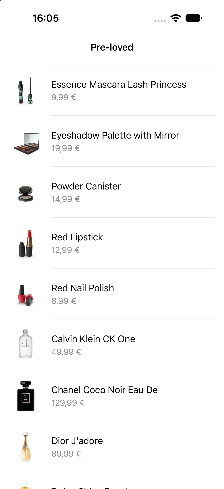
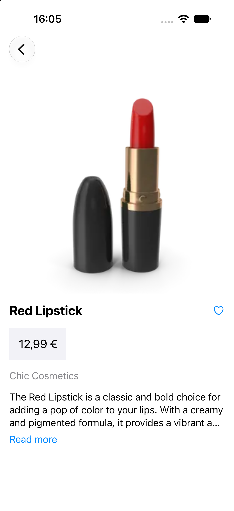
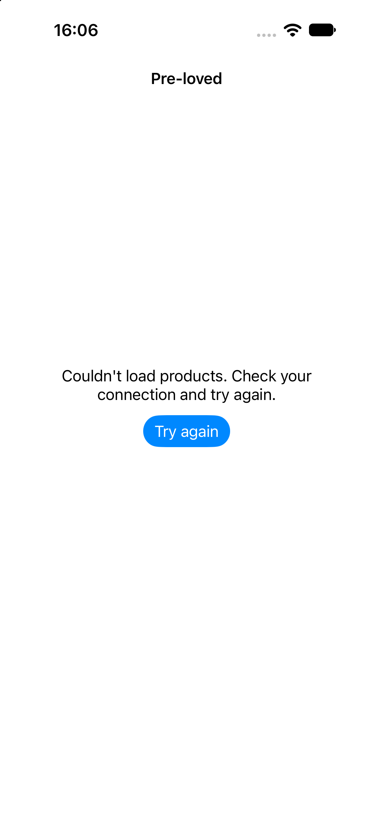

# Pre-loved

This is a **learning project**: my first iOS app, built while moving from frontend development (React, TypeScript) to iOS.

Theme: A small Vinted-style browser for second-hand items, built in Swift.

**UIKit + Clean Swift (VIP) · SwiftUI · Swift Testing**

  
  
  

## Features

- Product list loaded from the [DummyJSON](https://dummyjson.com) API, with thumbnails
- Loading and error states, with retry and pull to refresh
- Product detail screen with image, price, brand and an expandable description
- Favorite button (UI only for now)

## Built with

- Swift, with no third-party dependencies
- UIKit, built in code (no storyboards), for the product list
- SwiftUI for the detail screen, embedded with `UIHostingController`
- Clean Swift (VIP) architecture for the list
- async/await networking with `URLSession`, decoding JSON with `Decodable`
- Swift Testing for unit tests

## Architecture

The product list follows Clean Swift (VIP), with data flowing one way:

ProductListViewController → ProductListInteractor → ProductListPresenter → ProductListViewController

| Part | Responsibility |
|---|---|
| `ProductListViewController` | Shows the UI and forwards user actions |
| `ProductListInteractor` | Loads products, ignores duplicate loads, handles selection |
| `ProductListPresenter` | Formats data for display |
| `ProductService` | Fetches and decodes products |
| `ProductListRouter` | Opens the detail screen |

Dependencies are protocols passed in through `init`, so each part can be tested with fakes.
The detail screen is a plain SwiftUI view without VIP, because it only displays one product.

## Project structure

    Preloved/
    ├── Scenes/
    │   ├── ProductList/      VIP: view controller, interactor, presenter, router, models
    │   └── ProductDetail/    SwiftUI detail view
    ├── Models/               Product, sample data
    ├── Services/             ProductService, ImageLoader
    └── Helpers/              PriceFormatter
    PrelovedTests/            Unit tests

## Running the project

Requirements: Xcode 27 and an iOS simulator.

1. Clone the repository.
2. Open `Preloved.xcodeproj`.
3. Choose an iPhone simulator and press **⌘R** to run.
4. Press **⌘U** to run the tests.

No API key is needed.

## Tests

- **Decoding:** `Product` decodes from JSON, including when `brand` is missing
- **Presenter:** prices are formatted for display, and errors produce the error state
- **Interactor:** loading then products, loading then error, selecting a row opens the right product, an invalid index does nothing

The tests use hand-written fakes: stubs for inputs (the service) and spies for outputs (presenter, router, view).

## What I learned

- **UIKit is imperative.** Coming from React, building the list in UIKit felt like writing vanilla DOM code: creating views and adding subviews by hand. Changing data doesn't update the screen until you call `reloadData()`. Building the detail screen in SwiftUI afterwards made it interesting to compare.
- **Existing knowledge transferred well.** Swift optionals and enums with associated values map closely to Scala's `Option` and sealed traits, and protocols felt familiar from TypeScript interfaces.
- **VIP broke my brain at first.** Having the Interactor push results to the Presenter, which then calls the View, instead of returning data, felt backwards. It clicked when one action had to produce several results over time: loading, then products or an error, plus refreshes that should be ignored while a load is running.
- **Testing felt simpler than I expected.** Because every dependency is a protocol passed through `init`, fakes are just small hand-written classes. I didn't need module mocking like in Jest (although this is a small app).
- **SwiftUI previews** were my favourite tool: I could check edge cases like a missing brand, a long title or dark mode without running the app.
- **Learning with an AI tutor.** I built this with AI guidance, and it was nice to see that even in an unfamiliar stack I could spot design problems. For example: replaced separate display functions with a single screen state enum after adding loading and noticing growing complexity (spinner controlling).

## What I'd improve next

- Save favorites and show them in the list
- Pagination for long lists (fetch not only first 30 products)
- Take the currency from the API